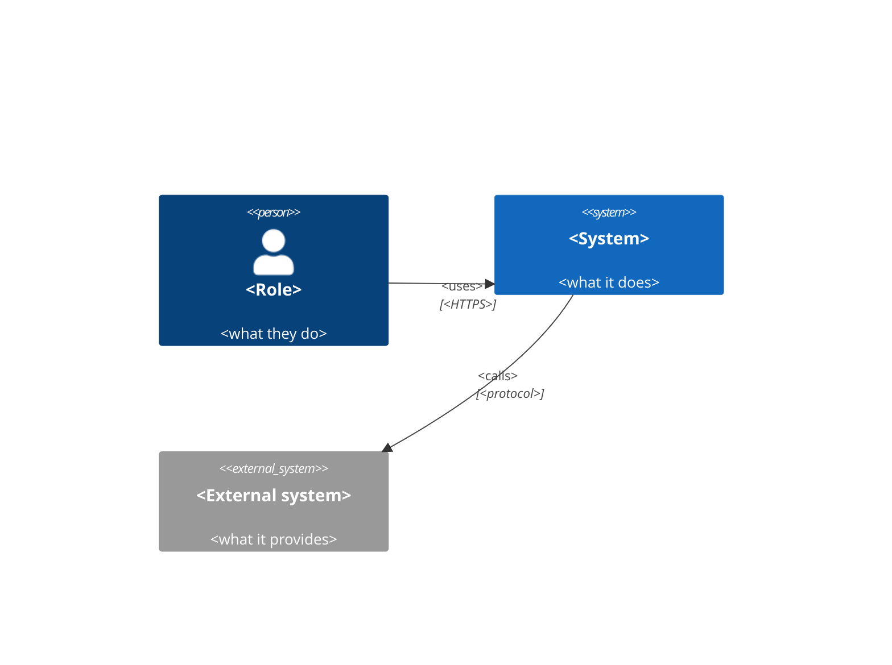
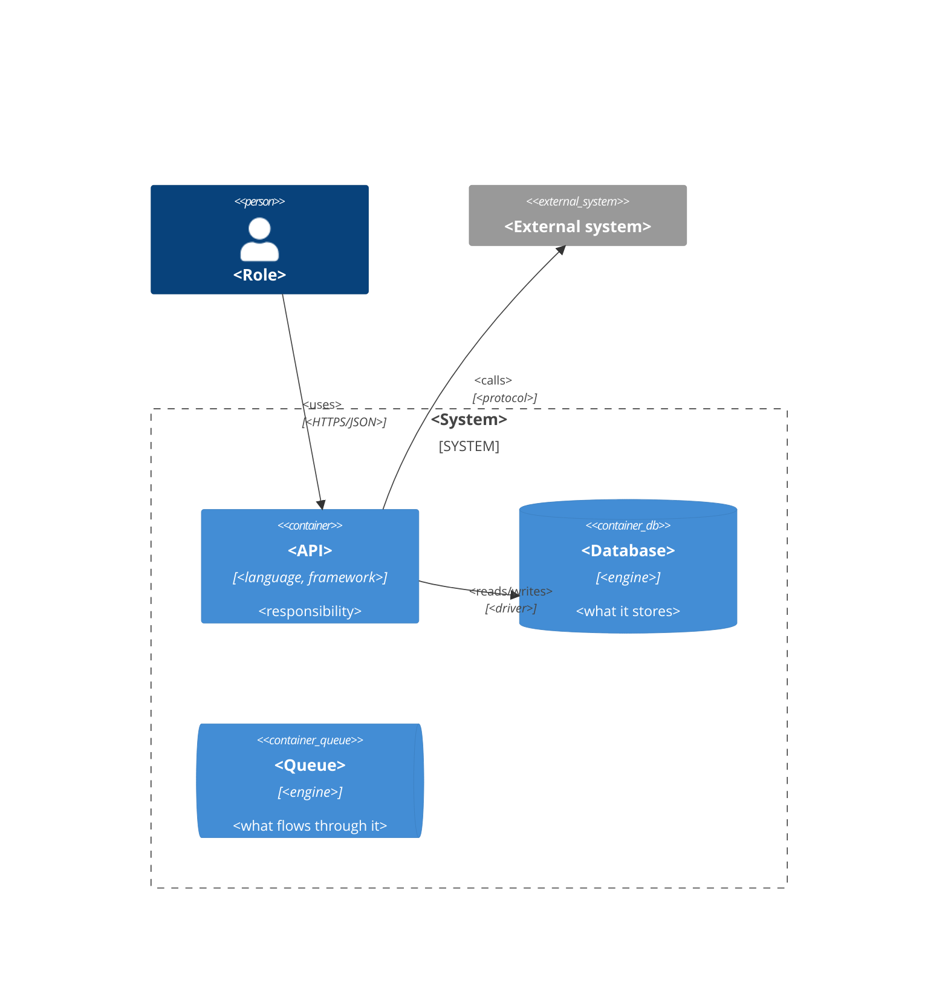
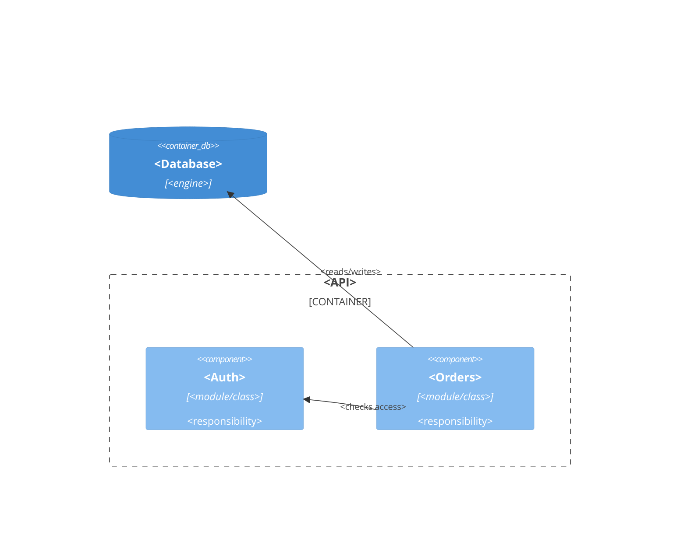
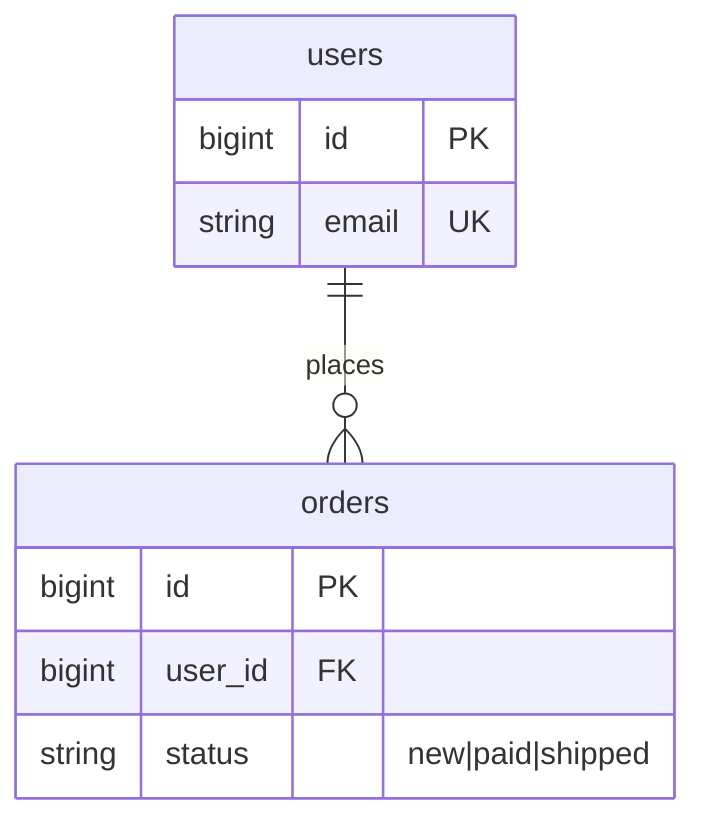

# Templates — diagram files

Each file is exactly: H1, one line, one `mermaid` block. Replace every element
with real ones from the code. Element ids are short snake_case; labels are what
people call the thing.

## `architecture/c4-context.md`

````markdown
# C4 Context

Who uses the system and which external systems it talks to.


````

## `architecture/c4-container.md`

````markdown
# C4 Container

Deployable parts of the system and how they communicate.


````

## `architecture/c4-component-{name}.md` (optional)

````markdown
# C4 Component — <container>

Main components inside <container> and their dependencies.


````

## `database/erd.md`

Every table, every column with type and key markers (`PK`, `FK`, `UK`), and every
relationship. Enum values go in the column comment. Pivot tables are included.

````markdown
# ERD

All tables, columns and relationships of <database>.


````

## `decisions/NNNN-{slug}.md` (optional)

```markdown
# NNNN. <Decision>

- Context: <what forced a choice>
- Decision: <what was chosen>
- Consequences: <what it costs, what it rules out>
```
